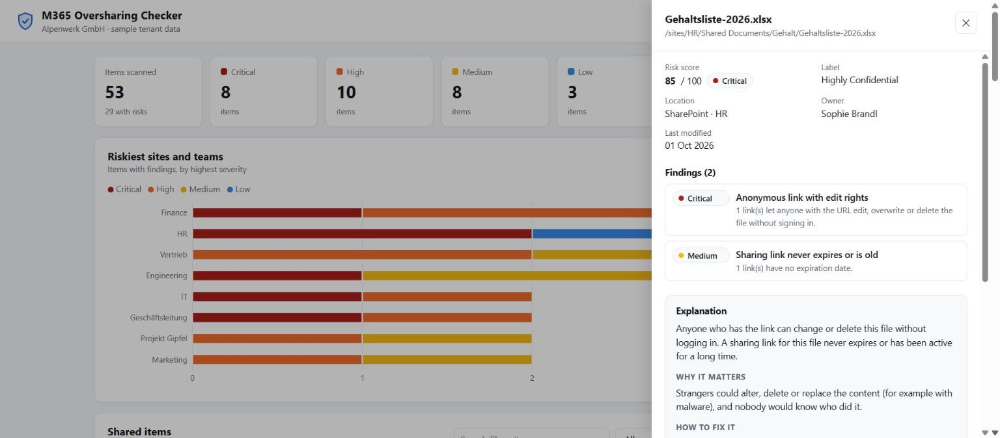
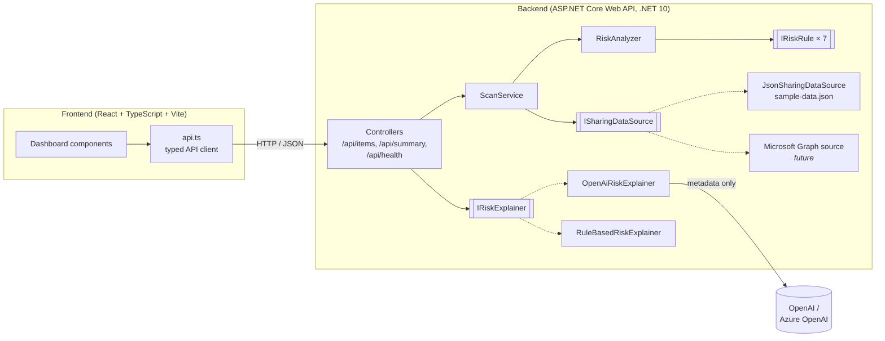

# M365 Oversharing Checker

[](https://github.com/ibrahimbelkahla/m365-oversharing-checker/actions/workflows/ci.yml)


A web dashboard that scans Microsoft 365 sharing data (files in SharePoint, OneDrive and Teams with their
permissions), detects **oversharing** risks, scores them, and uses AI to explain each risk in plain language
and suggest how to fix it.

## What is oversharing and why does it matter?

Oversharing means files are accessible to more people than necessary: an "Anyone with the link" share on a
salary list, a confidential contract shared with a personal email address, or a strategy deck that every
employee can open. Each share usually starts with a good reason, but links are forgotten and permissions pile up.
The result is data leaks, GDPR violations and lost trust. With AI assistants like Microsoft 365 Copilot,
which can surface everything a user has access to, oversharing becomes visible much faster.



> The app runs on **sample data** for the fictional company *Alpenwerk GmbH* (all people and domains are invented,
> using the reserved `.example` domain). No real Microsoft 365 tenant is needed.

## Features

- **Risk engine** with seven independent, unit-tested rules and a 0–100 risk score per file
- **Dashboard**: totals per severity, external shares, average score, and a chart of the riskiest sites and teams
- **Item table** sorted by risk, with search and filters (severity, location, sensitivity label)
- **Detail panel** with all permissions, findings and an **"Explain with AI"** button
- **AI explanations** via OpenAI or Azure OpenAI, with a rule-based fallback, so the app also works without an API key
- **Privacy by design**: only metadata is sent to the AI, never names or email addresses
- Light and dark mode, works on laptop and phone widths
- REST API with OpenAPI / Swagger UI, CI with GitHub Actions

## Risk rules

| # | Rule | Severity |
|---|------|----------|
| 1 | **"Anyone" link** (anonymous access, view) | Low (Public) · Medium (Internal) · High (Confidential) · Critical (Highly Confidential) |
| 2 | **External guest with edit rights** | High |
| 3 | **Confidential file shared externally** | High (Confidential) · Critical (Highly Confidential) |
| 4 | **Organization-wide link on a sensitive file** | Medium (Confidential) · High (Highly Confidential) |
| 5 | **Sharing link without expiration or older than 90 days** | Medium (Anyone link) · Low (organization link) |
| 6 | **Shared directly with more than 25 people** (configurable) | Medium |
| 7 | **"Anyone" link with edit rights** | Critical, always |

**Risk score:** the most severe finding sets the base score (Critical 80, High 60, Medium 35, Low 15).
Each additional finding adds 5 points, up to a maximum of 100. Items without findings score 0.

## Architecture



```
backend/          ASP.NET Core Web API (C#)
  Data/           ISharingDataSource, JSON implementation, Graph-shaped DTOs + mapper, sample data
  Models/         SharedItem, Permission, enums
  Risk/           IRiskRule, RiskAnalyzer, RiskScoreCalculator, Rules/ (one class per rule)
  Explanations/   IRiskExplainer, OpenAI and rule-based implementations, prompt builder
  Services/       ScanService (filtering and dashboard summary)
  Controllers/    REST endpoints
backend.Tests/    xUnit tests (rules, score, explainers, mapper, API integration tests)
frontend/         React + TypeScript + Vite dashboard, Vitest tests
```

### API

| Method | Endpoint | Description |
|--------|----------|-------------|
| `GET` | `/api/items?severity=&location=&label=` | All items with findings and score, riskiest first |
| `GET` | `/api/items/{id}` | One item with details |
| `GET` | `/api/summary` | Totals per severity, external shares, riskiest sites/teams |
| `POST` | `/api/items/{id}/explain` | Plain-language explanation and fix steps |
| `GET` | `/api/health` | Status and the active explainer (AI or rule-based) |

## Run it locally

**Requirements:** [.NET 10 SDK](https://dotnet.microsoft.com/download) and [Node.js 22+](https://nodejs.org/).

**1. Backend** (http://localhost:5110, Swagger UI at http://localhost:5110/swagger)

```bash
dotnet run --project backend
```

**2. Frontend** (http://localhost:5173), in a second terminal

```bash
cd frontend
npm install
npm run dev
```

**3. Tests**

```bash
dotnet test                 # backend: xUnit
cd frontend && npm test     # frontend: Vitest
```

### Optional: enable AI explanations

Without a key the app uses the rule-based explainer. To use OpenAI, store the key with
[user secrets](https://learn.microsoft.com/aspnet/core/security/app-secrets) (saved in your user profile, outside the repository):

```bash
dotnet user-secrets set "OpenAI:ApiKey" "sk-..." --project backend
dotnet user-secrets set "OpenAI:Model" "gpt-4.1-mini" --project backend   # optional
```

For **Azure OpenAI**, also set the endpoint. `Model` is then your deployment name:

```bash
dotnet user-secrets set "OpenAI:AzureEndpoint" "https://<your-resource>.openai.azure.com" --project backend
dotnet user-secrets set "OpenAI:Model" "<your-deployment-name>" --project backend
```

Environment variables work too (`OpenAI__ApiKey`, or the common `OPENAI_API_KEY`).
Restart the backend; the header of the dashboard then shows the active AI model.

## Design decisions

- **Interfaces for the data source and the explainer.** `ISharingDataSource` hides where data comes from:
  today a JSON file, tomorrow Microsoft Graph, with no change to the risk engine, API or UI.
  `IRiskExplainer` works the same way for OpenAI vs. rule-based explanations; the implementation is chosen once at startup.
- **Graph-shaped sample data.** `sample-data.json` mimics Microsoft Graph `driveItem` and `permission` responses
  (`roles`, `link.scope`, `grantedToV2`, …). `GraphItemMapper` translates them into clean domain models,
  so a real Graph data source can reuse the same mapping. External guests are detected by comparing the
  email domain with the tenant domain.
- **One class per rule.** Each rule implements `IRiskRule` and is registered in dependency injection.
  Rules are small, independently testable, and a new rule doesn't require changes to existing code.
- **Testable time.** The "older than 90 days" rule uses .NET's `TimeProvider`, so tests run with a fixed date.
- **No keys in code.** API keys only come from user secrets or environment variables; `.gitignore` excludes secret files.
- **Metadata-only prompts.** The AI receives the file name, sensitivity label, permission *counts* and finding titles,
  never names or email addresses. A unit test checks that the request contains no `@`.
- **Graceful failure.** If the AI call fails, the API returns a clear `502` problem response and the UI shows
  the error with a retry button.

## Next steps

- **Real Microsoft Graph integration**: an Entra ID app registration with `Sites.Read.All` / `Files.Read.All`
  (application permissions) and a `GraphSharingDataSource` using the Microsoft Graph SDK
- **Azure deployment**: App Service or Container Apps for the API, Static Web Apps for the frontend,
  Key Vault and managed identity instead of API keys
- **Scheduled scans** with a background worker or Azure Functions, storing history to show trends over time
- **Automatic remediation suggestions**: one-click actions such as "remove anyone link" or "set expiration"
  via Graph, with an approval step for the file owner

## License

[MIT](LICENSE) © Ibrahim Belkahla
